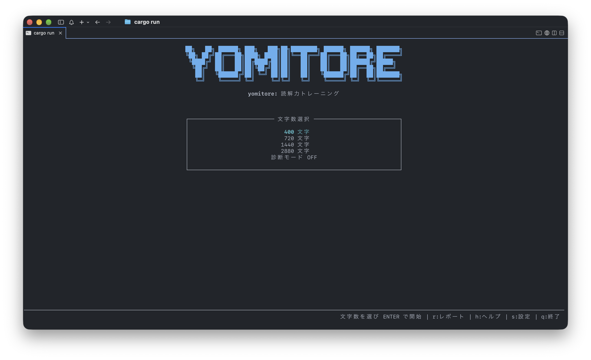
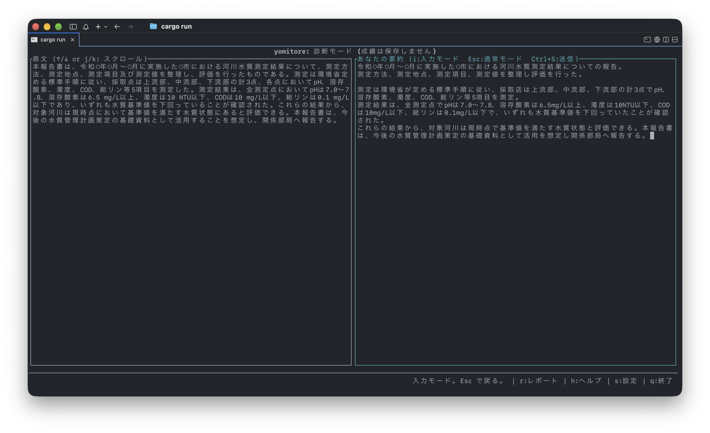
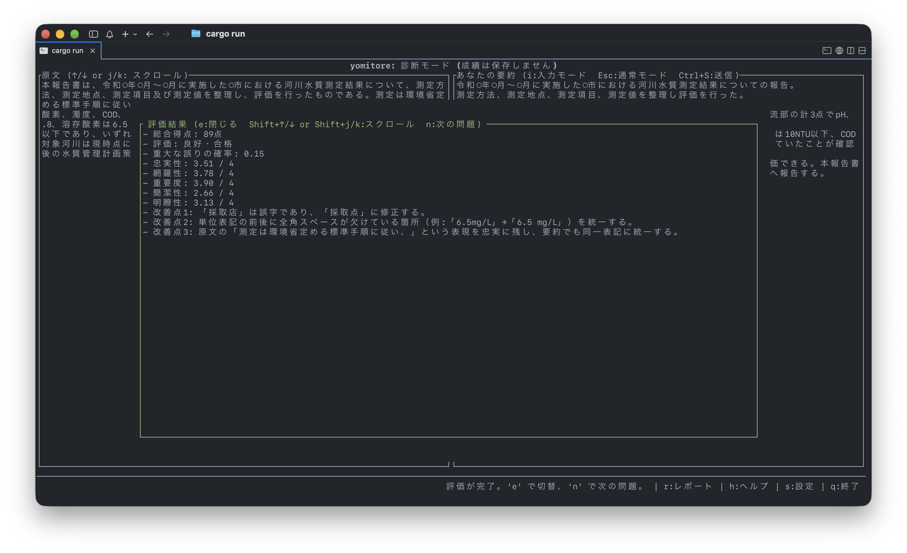
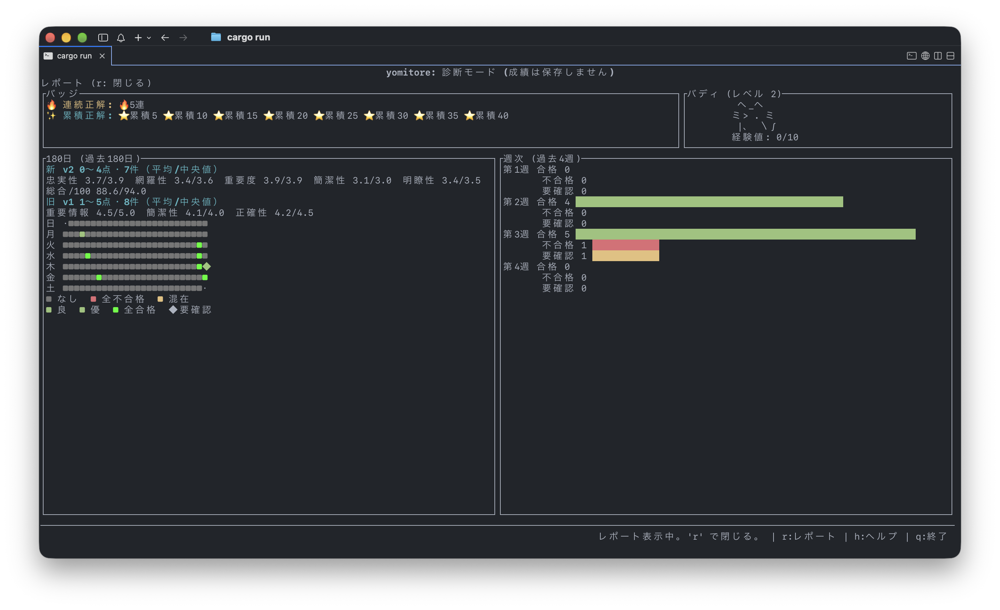

# yomitore (読トレ)

日本語(読)解力(トレ)ーニングアプリ

## 概要

`yomitore` は、AI を通じて日本語の読解力を鍛える TUI アプリケーションです。Groq で練習用の文章を生成し、TypeSafe AI の Jev でユーザが入力した要約からユーザが基の文章を理解しているか評価します。Jev が得点と合否を決め、Groq が読み返す箇所を示します。主要なデスクトップオペレーティングシステム (Windows, macOS, Linux) で動作します。









## 特徴

1. **AI による文章生成**: アプリケーションは、AI に対してフォーマルな文章を要求します。文章の長さは以下から選択可能です。
   - 400 字: 簡単な文章 (原稿用紙一枚)
   - 720 字: 中程度の文章 (A4 用紙半分)
   - 1440 字: 複雑な文章 (A4 用紙一枚)
   - 2880 字: 長い文章 (A4 用紙二枚)
2. **AI による評価**: Jev が明示情報、全体の意味、関係・推論の理解と、重大な読み違いの有無を評価します。アプリは0〜100点の総合得点と最終判定を表示し、Groq は確認できた理解、読み違いなど、原文の根拠や読み返す箇所を示します。
3. **継続的なループ**: フィードバックを受けた後、ユーザは次の問題に進むことができ、継続的な練習が可能です。
4. **グラフ**: 直近180日と週次の正誤履歴を、週横軸・曜日縦軸のヒートマップや棒グラフで確認できます。
5. **スコア**: 直近180日の平均値と中央値を採点方式別に表示します。週次レポートでは合格、不合格、要確認の件数を確認できます。
6. **レイアウト**: 2 分割のブロックに、AI による診断結果を表示するフローティングブロックで見やすく利用可能 (100x30 のターミナルサイズが必要です)。
7. **アワード**: 連続正解数 (ストリーク) や累積正解数に応じて、アワードが授与されます。
8. **バディ**: 以下のキャラクターを育成することができます。育成には、正解数に応じて得られるポイントを使用します。なお、バディは2コマアニメーションします。

   ```text
   レベル 1    →    レベル 2    →    レベル 3
     ╱|、            ヘ_ヘ           ヘ_ヘ
   (˚ˎ。7           ミ. . ミ        ミ. . ミ
    |、˜〵〜          |、 〵〜        (    )〜
   ```

## 要件

- [Rust](https://www.rust-lang.org/tools/install) 1.100 以上 (`cargo` を含む)

## セットアップ

### API キーの設定

文章生成には [GroqCloud](https://console.groq.com/keys) の API キー、読解の評価には [TypeSafe AI](https://docs.typesafe.ai/introduction) の Jev API キーが必要です。起動後にタイトル画面の `s` で設定画面を開き、両方のキーを保存できます。保存済みキーの値は画面に再表示されません。

Groq キーは以下の方法でも設定できます。環境変数が設定ファイルより優先されます。Jev キーは設定画面または設定ファイルで設定します。

1. **環境変数 (推奨)**:
   `GROQ_API_KEY` 環境変数を設定します。

   ```sh
   export GROQ_API_KEY="your_api_key_here"
   ```

2. **設定ファイル**:
   以下のパスに設定ファイル `config.toml` を手動で作成し、API キーを設定します。

   **ファイルパス**:
   - **Linux**: `~/.config/yomitore/config.toml`
   - **macOS**: `~/Library/Application Support/yomitore/config.toml`
   - **Windows**: `%APPDATA%\yomitore\config.toml`

   **内容**:

   ```toml
   api_key = "your_api_key_here"
   jev_api_key = "your_jev_api_key_here"
   ```

   ※ アプリケーション起動時に、このファイルに有効なキーが保存されている場合は、自動的に読み込まれます。

## 実行方法

1. リポジトリをクローンします (まだの場合)：

   ```sh
   git clone https://github.com/tkumata/yomitore.git
   cd yomitore
   ```

2. `cargo` を使用してアプリケーションを実行します：

   ```sh
   cargo run
   ```

3. リリースバイナリをビルドするには：

   ```sh
   cargo build --release
   ```

   実行ファイルは `target/release/yomitore` に配置されます。

## インストール

```sh
cargo install --path .
```

`~/.cargo/bin` にインストールされます。

## 操作方法

[HELP](./docs/HELP.md) を参照してください。
