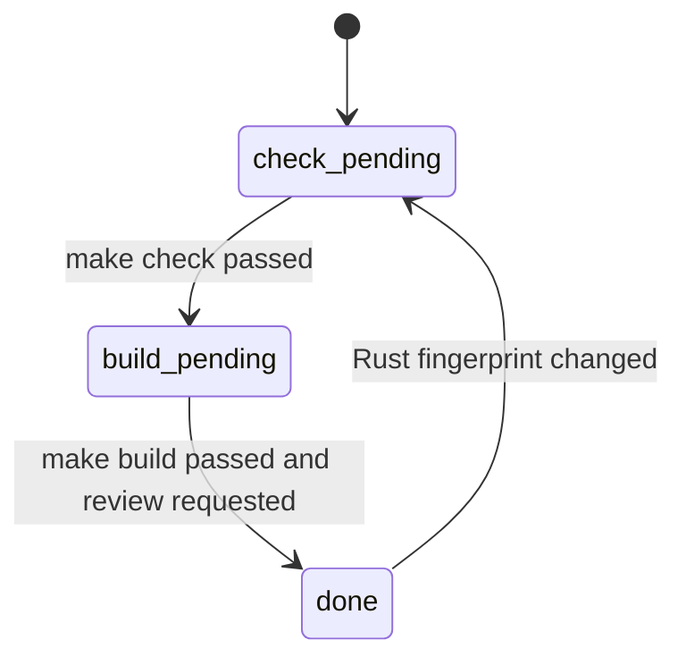

# DESIGN

## Rust 1.100 対応と端末復元

- 最低対応バージョンを `Cargo.toml` の `rust-version = "1.100"` で宣言し、edition 2024 を維持する。`rust-toolchain.toml` は使用しない
- `tui.rs` は初期化途中の失敗時、`main.rs` は初期化成功後のエラー終了と panic の巻き戻し時に、`DropGuard` から端末を復元する
- 正常終了時はガードを解除して明示的に復元し、復元エラーを呼び出し元へ返す。ガードによる復元の失敗は標準エラー出力へ通知する
- 代替画面の解除が失敗しても raw mode の解除を試み、両方が失敗した場合は両方のエラーを通知する
- バディ表示の先頭改行除去に `str::trim_prefix`、評価結果の表示切り替えに `bool::toggle` を使用する
- `config.rs` は一時ファイルの作成成功後に `DropGuard` を設置し、保存失敗や panic の巻き戻し時に削除を試みる。ファイルを閉じてから削除・置換し、保存成功時はガードを解除する。権限、同期、OS 別の置換・バックアップ処理とエラー返却は維持する
- `stats_analysis.rs` は `Vec::from_fn` で週別統計を生成する。件数、古い週からの並び順、週番号、開始を含み終了を含まない期間境界、0週時の空配列を維持する

## Jev による要約評価とキー設定

- `config.rs` は Groq・Jev のキーの読み書きを担う。Groq の `GROQ_API_KEY` 優先を維持し、既存の値を保持した内容を一時ファイルに書いてから置き換える。Unix 系の設定ファイル権限は0600とする
- `events.rs` と `app.rs` はメニュー・トレーニング画面から開く設定画面の入力状態と、保存・キャンセル後に元の画面へ戻す遷移を担う。`ui.rs` はキーを伏せて描画し、保存結果とエラーを表示する
- Groq の認証はトレーニング開始時に行う。キーが無効でも設定画面を開けるよう、起動時の認証失敗ではアプリを終了しない
- `api_client.rs` は Jev の型付き回答と Groq の改善点を取得する。Jev の6質問は1回の要求にまとめ、両サービスへ原文と要約文を渡す
- `evaluation.rs` は Jev の質問、外部応答の検証、重み付き得点と最終判定の計算、改善点3件の解析、結果の整形を担う
- 5つの Score の元値を重み付きで加算し、丸め後の総合得点と Noul の確率でアプリが判定する。`main.rs` は同じ判定を評価画面と保存に渡す
- `models.rs` は v1 と v2 の保存形式を扱う。`stats_store.rs` はロックとファイル置き換えで履歴を保存する。新規レコードには v2 の項目点、総合得点、重大な誤りの確率、最終判定、改善点を保存する
- 片方の API が失敗した評価は結果として保存しない。キーと API 応答全文はエラー表示やログに含めない
- `ApiClient` は両サービスで60秒のタイムアウトを設定したHTTPクライアントを共有する。初期化失敗と成功以外のHTTPステータスはエラーとして返す
- 原文は生成成功時に設定する。空の応答は生成失敗として扱う。原文がない間は評価を送信できず、生成失敗時は `n` で再試行する

## 成績履歴の保存

- `stats_store.rs` がJSONの読み書きを担い、`stats.rs` がバディ、バッジ、連続正解数の規則を担う
- 起動時に既存の履歴を読み込めなければ理由を表示し、そのセッションの保存を止める
- 保存時は専用のロックファイルを使い、最新履歴の読み込み、結果の追加、一時ファイルへの書き込みと同期、履歴の置き換えまでを排他的に行う。成績とバディの表示は保存成功後に更新する
- 保存に失敗した場合は評価結果をメモリに保持し、`Ctrl+S` で保存を再試行する

## 起動時メニューの中央寄せ

- 起動直後の文字数選択メニューは、選択状態によって文字列幅が変わらないようにする
- 選択状態は文字列の増減ではなくスタイルで表現し、メニュー全体が中央に見えることを優先する
- 起動直後の縦配置は、最上部の 1 行余白、タイトルロゴ、1 行余白、アプリ名、3 行余白、文字数選択ブロックの順に固定する
- 文字数選択ブロック内は選択肢を 1 行ずつ並べ、項目間に空行を入れない

## 評価結果ダイアログ余白追加

- 画面全体に対して上下左右2セルの余白を確保するため、全体領域から内側に縮めた利用可能領域を導入する
- ダイアログのサイズと位置は利用可能領域を基準に計算する
- 最小サイズ定数は維持しつつ、利用可能領域を超える場合は利用可能領域に合わせて縮める
- 既存の評価結果ダイアログのみを対象とし、他の画面やオーバーレイは変更しない

## バディ機能

- `TrainingStats` 構造体に `Buddy` 構造体を追加し、レベルと経験値を管理する
- トレーニング合格時に経験値を加算し、閾値（5回）を超えたらレベルアップさせる
- 統計データ読み込み時（アプリ起動時等）に、最終トレーニング日時と現在日時を比較し、3日以上経過していればレベルダウンさせる
- レポート画面(`reports.rs`)の右側にバディの ASCII アートを表示する
- ASCII アートはレベルごとに変化させる（例: 卵 -> 幼体 -> 成体）

## テスト導入

- `ApiClient` は単一の具象型として `App` が直接保持する
- Jev 応答の検証・得点計算と Groq の改善点解析を API 通信から分離し、ユニットテストで検証する
- テストはモジュール名ベースで絞り込み実行できる構成にする
- Jev の6回答と Groq の改善点3件を必須とし、壊れた応答はエラーにする
- 評価結果の表示は固定順とし、5つの項目点は0〜4の小数、総合得点は0〜100の整数で表示する
- パース失敗時は評価結果オーバーレイにエラーメッセージを表示する
- Groq の改善点の余分な行は無視し、先頭の箇条書き記号が異なっていても解釈する

## AI エージェントハーネスのレビューゲート

- `check` と `build` は通過条件であり、完了条件ではない
- Rust 関連差分のフィンガープリントを保存し、同一差分の検証を繰り返さない
- 未検証差分では `make check`、次の Stop で `make build` の順に実行する
- `build` 成功後はコードレビューを要求し、Rust 関連差分が変わった場合だけ再検証する

## レポートヒートマップ改善

- `stats_analysis.rs` は日次・週次の合格、不合格、要確認を集計する。`reports.rs` はヒートマップと週次チャートを描画する
- 対象期間は今日を含む直近180日とする
- 横軸は週とし、左から古い週、右へ新しい週を配置する
- 週列は日曜始まりで作り、各列には最大7日分のセルを縦に配置する
- 週列ヘッダーは描画しない
- 曜日ラベルと日別セルは、上から日、月、火、水、木、金、土の順に行を作る
- 対象期間外、またはその週に存在しない曜日の交点は `·` で表示し、対象期間内は `■` を表示する。要確認があった日は `◆` を表示する
- セル間隔を最小限に詰める
- 色は確定した結果の合格率を示す。要確認だけの日は黄色で表示する
- UTF-8 を表示できる端末を前提とする
- 端末幅が不足する場合も、曜日ラベルと週列の対応が崩れないよう固定幅計算で切り詰める

## 成績レポート対象期間の180日化

- 成績レポートの対象期間は `reports.rs` の定数で一元管理する
- 評価スコア集計と日次ヒートマップは同じ対象日数を使う
- 評価スコア集計と日次ヒートマップは、描画時に一度取得したローカル日付を共通の期間末日とする
- `stats_analysis.rs` は日数を引数に取り、方式別に評価の平均と中央値を集計する
- v1 の3項目は1〜5点で集計し、v2 の5項目は0〜4点、総合得点は0〜100点で集計する
- 表示文言は直近180日で統一し、90日を示す古い文言を残さない
